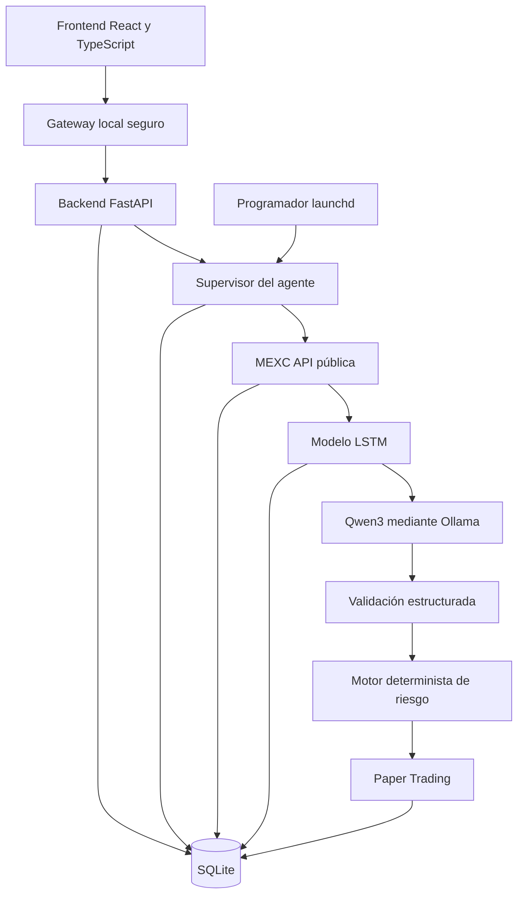
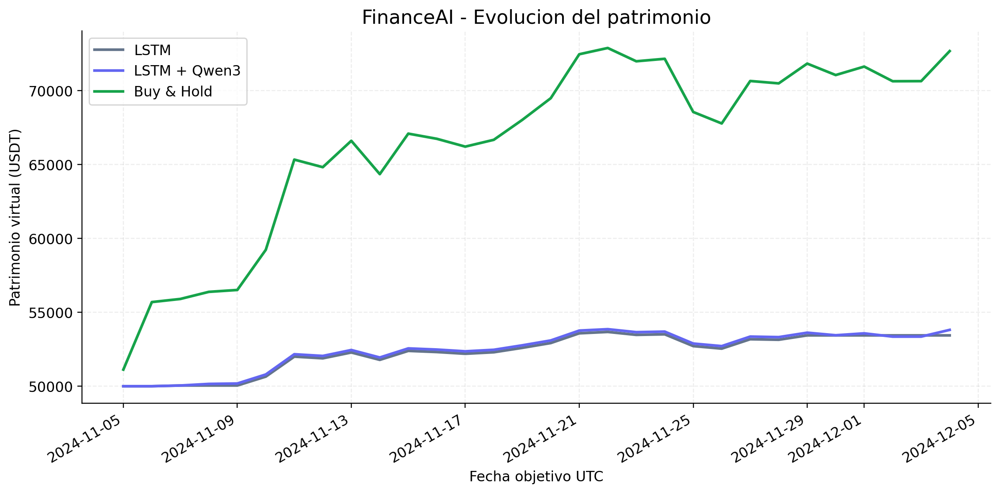
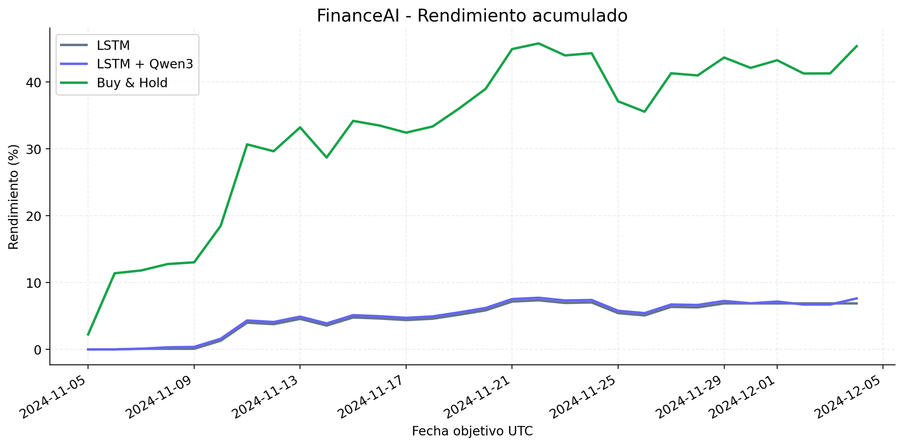
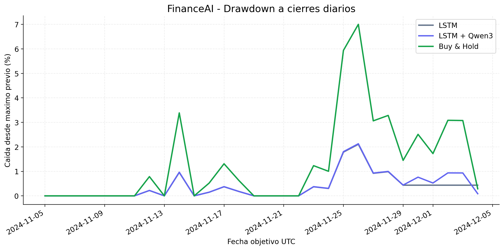

# FinanceAI

### Intelligent Trading — Deep Learning & AI Agent


**Proyecto académico de predicción financiera mediante Deep Learning
e integración de un agente local de inteligencia artificial.**

FinanceAI combina una red neuronal LSTM, un modelo de lenguaje Qwen3,
un motor determinista de riesgo, una base de datos SQLite y una
plataforma web para analizar Bitcoin y realizar operaciones
exclusivamente simuladas.

No utiliza dinero real ni permite enviar órdenes reales a MEXC.

## Índice

1. [Objetivo](#objetivo)
2. [Características](#características)
3. [Arquitectura](#arquitectura)
4. [Metodología experimental](#metodología-experimental)
5. [Modelo predictivo](#modelo-predictivo)
6. [Agente de inteligencia artificial](#agente-de-inteligencia-artificial)
7. [Motor de riesgo](#motor-de-riesgo)
8. [Base de datos](#base-de-datos)
9. [Tecnologías](#tecnologías)
10. [Resultados financieros](#resultados-financieros)
11. [Estructura del proyecto](#estructura-del-proyecto)
12. [Ejecución local](#ejecución-local)
13. [Automatización](#automatización)
14. [Pruebas y seguridad](#pruebas-y-seguridad)
15. [Limitaciones](#limitaciones)
16. [Estado del proyecto](#estado-del-proyecto)

## Objetivo

Desarrollar y evaluar un sistema financiero experimental que
combine modelos de aprendizaje profundo con un agente de inteligencia
artificial capaz de interpretar pronósticos, proponer decisiones
y operar dentro de restricciones financieras verificables.

El proyecto compara una estrategia basada exclusivamente en
un modelo predictivo, una estrategia asistida por un LLM y una
estrategia pasiva Buy & Hold.

## Características

- Predicción diaria del rendimiento de BTCUSDT.
- Red neuronal LSTM con indicadores técnicos.
- Consulta de información pública de mercado mediante MEXC.
- Agente Qwen3 ejecutado localmente mediante Ollama.
- Decisiones estructuradas BUY, SELL y HOLD.
- Validación independiente de las propuestas del agente.
- Simulación financiera Paper Trading.
- Persistencia de decisiones, órdenes, patrimonio e incidentes.
- Dashboard interactivo desarrollado en React y TypeScript.
- Automatización diaria mediante launchd.
- Recuperación controlada y protección contra ciclos duplicados.
- Paro de emergencia.
- Evidencias experimentales y pruebas automatizadas.

## Arquitectura



El modelo de lenguaje no tiene autoridad directa para ejecutar
operaciones. Toda propuesta debe superar las validaciones
del supervisor y del motor de riesgo.

## Metodología experimental

El desarrollo experimental contempla:

- Serie temporal diaria de BTCUSDT.
- Separación cronológica de entrenamiento, validación y prueba.
- Proporciones aproximadas de 70%, 15% y 15%.
- Escalamiento ajustado únicamente con entrenamiento.
- Comparación de modelos de referencia, MLP y LSTM.
- Evaluación mediante ventanas temporales y semillas reproducibles.
- Selección de hiperparámetros mediante validación.
- Conservación del conjunto de prueba para evaluación final.
- Congelación del modelo seleccionado y sus escaladores.

La integración del agente utiliza el modelo congelado, sin realizar
un nuevo entrenamiento ni reevaluar el conjunto de prueba.

## Modelo predictivo

| Parámetro | Valor |
|---|---|
| Identificador | TEC_B_LSTM_S42 |
| Versión | 1.0.0 |
| Activo | BTCUSDT |
| Ventana | 20 |
| Forma de entrada | `[None, 20, 3]` |
| Variables | `['Return', 'SMA_Distance_20', 'Volatility_20']` |
| Parámetros | 1425 |
| Umbral | 0.001 |

El modelo estima el rendimiento del siguiente periodo diario
a partir de información disponible al cierre de la vela de referencia.

Los artefactos congelados se encuentran en:

`models/modelo_final_v1/`

El manifiesto permite verificar su integridad mediante SHA-256.

## Agente de inteligencia artificial

FinanceAI utiliza `qwen3:8b` mediante Ollama en un entorno local.

El agente recibe información estructurada que incluye:

- Pronóstico generado por el LSTM.
- Rendimientos históricos recientes.
- Indicadores técnicos.
- Estado de la cartera.
- Efectivo y exposición.
- Restricciones financieras.
- Fecha y antigüedad de los datos.

El resultado debe cumplir un esquema de validación antes de ser
considerado por el motor de riesgo.

Las acciones permitidas son BUY, SELL y HOLD.

Ollama se ejecuta localmente, con las funcionalidades de nube
deshabilitadas en el flujo implementado.

## Motor de riesgo

| Restricción | Configuración inicial Paper Trading |
|---|---|
| Capital inicial | 50,000 USDT virtuales |
| Activo | BTCUSDT |
| Exposición para nuevas compras | 25% |
| Límite diario de pérdida para nuevas compras | 2% |
| Antigüedad máxima de vela | 3,600 segundos |
| Orden mínima | 10 USDT |
| Comisión simulada | 0% |
| Deslizamiento simulado | 0% |
| Apalancamiento | No |
| Posiciones cortas | No |
| Dinero real | No |

El límite del 25% restringe nuevas compras. Las posiciones existentes
pueden superar dicho porcentaje debido a la apreciación del activo,
ya que no se aplica un rebalanceo obligatorio.

El límite de pérdida diaria tampoco constituye una garantía
de que el patrimonio no pueda caer más de ese porcentaje.

## Base de datos

SQLite conserva los datos y las relaciones del sistema.

| Tabla | Función |
|---|---|
| assets | Activos financieros |
| candles | Velas históricas |
| model_versions | Versiones del modelo |
| predictions | Pronósticos |
| portfolio | Carteras virtuales |
| positions | Posiciones financieras |
| risk_config | Configuraciones de riesgo |
| agent_cycles | Ciclos del agente |
| agent_decisions | Propuestas y decisiones autorizadas |
| orders | Órdenes simuladas |
| equity_history | Evolución del patrimonio |
| system_logs | Eventos del sistema |
| error_logs | Incidentes operativos |

El esquema principal contiene 13 tablas y se encuentra en:

[`database/schema.sql`](database/schema.sql)

Las simulaciones históricas se mantienen separadas de la cartera
principal. La copia histórica finalizada contiene además un registro
independiente de las liquidaciones.

## Tecnologías

| Tecnología | Versión o configuración |
|---|---|
| Python | 3.13.18 |
| TensorFlow | 2.21.0 |
| Keras | 3.13.2 |
| NumPy | 2.4.6 |
| Pandas | 2.2.3 |
| Scikit-learn | 1.6.1 |
| FastAPI | 0.165.0 |
| Uvicorn | 0.54.0 |
| Pydantic | 2.14.4 |
| Matplotlib | 3.10.0 |
| Pytest | 9.2.0 |
| React | ^19.3.1 |
| TypeScript | ~7.0.2 |
| Vite | ^8.4.0 |
| Node.js | v24.14.1 |
| npm | 11.11.0 |
| Ollama | 0.40.18 |
| Qwen3 | 8B |
| SQLite | Persistencia local |
| launchd | Programador nativo de macOS |

Entorno de integración verificado: macOS sobre arquitectura ARM64.

## Resultados financieros

### Simulación histórica comparativa

Periodo: 5 de noviembre al 4 de diciembre de 2024.

Capital inicial por estrategia: 50,000 USDT virtuales.

Comisiones y deslizamiento: 0%.

| Estrategia | Capital final USDT | Rendimiento | Drawdown máximo | Ejecuciones | Rechazos |
|---|---:|---:|---:|---:|---:|
| LSTM | 53,437.29 | 6.8746% | 2.1058% | 4 | 26 |
| LSTM + Qwen3 | 53,810.28 | 7.6206% | 2.1274% | 2 | 4 |
| Buy & Hold | 72,666.16 | 45.3323% | 7.0044% | 2 | 0 |

Se completaron 30 ciclos por estrategia, para un total de
90 ciclos históricos válidos. Las posiciones pendientes fueron
liquidadas al cierre del periodo.

### Comparación del agente con el modelo cuantitativo

La incorporación de Qwen3 produjo una diferencia favorable de
372.98 USDT frente al modelo
cuantitativo, equivalente a
0.7460
puntos porcentuales de rendimiento.

Los rechazos de riesgo disminuyeron
84.62%.
La latencia media de decisión aumentó aproximadamente
138.16 veces.

Buy & Hold obtuvo el mayor rendimiento durante el periodo observado,
con una asignación inicial del 100% a Bitcoin.

Como referencia complementaria, una asignación inicial pasiva del
25% a Bitcoin y 75% en efectivo, sin rebalanceo, obtuvo
11.3331% de rendimiento.
Esta referencia no forma parte de los 90 ciclos principales.

### Evolución del patrimonio



### Rendimiento acumulado



### Drawdown



Los resultados son retrospectivos y corresponden al conjunto VA.
No demuestran rentabilidad futura.

## Estructura del proyecto

```text
FinanceAI/
├── backend/
│   ├── app/
│   ├── run_dashboard.py
│   ├── run_scheduled_agent.py
│   └── scheduler_state.py
├── data/
│   └── processed/
├── database/
│   └── schema.sql
├── deployment/
│   └── macos/
├── experimental/
├── frontend/
│   ├── src/
│   ├── package.json
│   └── package-lock.json
├── models/
│   └── modelo_final_v1/
├── replay/
│   └── figuras/
├── results/
├── tests/
├── .env.example
├── .gitignore
└── README.md
```

El árbol representa la estructura del proyecto local.
La publicación y el paquete académico utilizarán una selección
auditada de archivos, excluyendo credenciales y archivos temporales.

## Ejecución local

Las siguientes instrucciones corresponden al entorno de FinanceAI
ya instalado, con su base de datos y modelo preparados.

```bash
cd "$HOME/Documents/FinanceAI"
source .venv/bin/activate
python -m backend.run_dashboard
```

Dashboard:

http://127.0.0.1:5173

Documentación interactiva de FastAPI:

http://127.0.0.1:8000/docs

El acceso a las rutas protegidas requiere autenticación.

Para detener los servidores, utilizar Control+C.

### Secciones del dashboard

- Dashboard
- Mercado
- Predicciones
- Agente IA
- Cartera
- Operaciones
- Riesgo
- Incidentes

La instalación desde cero deberá utilizar las dependencias fijadas,
la inicialización de SQLite, los artefactos del modelo y una
configuración local de credenciales.

El procedimiento completo se documentará en el manual de instalación.

## Automatización

FinanceAI integra el programador nativo launchd de macOS.

| Parámetro | Valor |
|---|---|
| Frecuencia | Diaria |
| Horario del centro de México | 18:05 |
| Horario UTC | 00:05 |
| Ventana de inicio UTC | 00:05–00:45 |
| Intentos automáticos diarios | Máximo uno |

Consultar el estado:

```bash
python -m backend.scheduler_state
```

Comprobar el ejecutor sin realizar operaciones:

```bash
python -m backend.run_scheduled_agent --check
```

La automatización requiere que la Mac esté disponible, con la
sesión correspondiente y conexión a internet.

El archivo launchd contiene rutas específicas del equipo y debe
adaptarse al instalar el proyecto en otra computadora.

Tener el servicio cargado no implica que la cartera esté autorizada
para operar. Los estados de pausa, recuperación y paro de emergencia
continúan siendo obligatorios.

## Pruebas y seguridad

| Control | Resultado de la auditoría |
|---|---|
| Pruebas automatizadas | 450/450 |
| Escenarios adversos | 10/10 |
| Controles de autenticación | 20/20 |
| Ciclos históricos | 90/90 |
| Inferencias Qwen3 válidas | 30/30 |
| Ejecuciones financieras históricas | 8 |
| Carteras históricas liquidadas | 3/3 |
| Figuras académicas | 6/6 |
| Tablas SQLite principales | 13 |

Ejecutar la suite de integración desde el entorno local preparado:

```bash
python -m pytest -q tests --ignore=tests/test_database.py
```

Algunas pruebas utilizan como referencia el estado inicial de la
cartera principal. Para repetir la auditoría después de operar,
debe emplearse un entorno de pruebas aislado y compatible.

Verificar el frontend:

```bash
cd frontend
npm run lint
npm run build
```

Los escenarios adversos incluyen:

- Fallos de conexión con MEXC.
- Límites de solicitudes HTTP 429.
- Datos desactualizados.
- Ollama desconectado.
- Respuestas JSON inválidas.
- Credenciales incorrectas.
- Saldo insuficiente.
- Ciclos duplicados.
- Reinicio y recuperación.
- Paro de emergencia.

Los fallos fueron comprobados mediante pruebas controladas.

Las credenciales no deben incluirse en GitHub ni en el paquete
de distribución. El archivo `.env.example` contiene la plantilla
de configuración, no la clave real del entorno.

## Limitaciones

- La simulación principal utiliza un periodo retrospectivo de
  30 días del conjunto de validación.
- Las estrategias no mantienen necesariamente la misma exposición.
- No se consideran costos reales de ejecución.
- El replay utiliza una ejecución idealizada a la apertura.
- El modelo de lenguaje puede incorporar conocimiento posterior
  al periodo histórico evaluado.
- Las métricas de operaciones ganadoras se basan en pocas
  operaciones cerradas.
- La automatización depende de la disponibilidad de la computadora.
- La predicción del rendimiento financiero contiene incertidumbre.
- Ningún resultado constituye una garantía de rentabilidad futura.

## Estado del proyecto

La auditoría técnica de integración fue aprobada con 450 pruebas,
sin fallos ni omisiones.

En el momento de la auditoría:

- Programador macOS instalado y cargado.
- Cartera principal pausada.
- Capital principal de 50,000 USDT virtuales.
- Sin operaciones ejecutadas en la cartera principal.
- Modelo LSTM original conservado.
- Sin reentrenamiento durante la integración.
- Sin reevaluación del conjunto TE.
- Primer ciclo automático con mercado actualizado pendiente.

## Finalidad académica

FinanceAI es un proyecto experimental y educativo.

No constituye asesoramiento financiero ni está diseñado
para ejecutar operaciones con dinero real.


## Historial de versiones y avances

La versión de la aplicación al cierre del desarrollo es
v0.1.0. El modelo predictivo congelado utiliza la versión
1.0.0. Las etapas siguientes representan avances del
desarrollo, no versiones publicadas individualmente.

| Etapa | Avance |
|---|---|
| Experimental | Preparación de datos, MLP, LSTM y evaluación |
| Reproducibilidad | Verificación del modelo congelado |
| 10 | Base SQLite y persistencia |
| 11 | Backend FastAPI y motor de riesgo |
| 12 | Integración de Qwen3 y supervisor |
| 13 | Dashboard React y autenticación |
| 14 | Replay, seguridad, automatización y auditoría |
| 15 | Documentación y paquete académico |
| Entrega final | Visualización de operaciones y PnL histórico |

### Verificación operativa del 26-27 de noviembre de 2026

- Conexión real a la API pública de MEXC verificada.
- 2522 velas diarias cerradas almacenadas.
- Dos predicciones registradas.
- Un ciclo manual completado.
- Acción propuesta y autorizada: HOLD.
- Cero órdenes en la cartera principal.
- PnL de la cartera principal: 0 USDT.
- Cero incidentes registrados al momento de la revisión.

### Visualización de resultados históricos

Las secciones Cartera y Operaciones incorporan una
consulta visual de los resultados del replay finalizado.

El panel utiliza una copia de los resultados extraídos
de SQLite, identificados explícitamente como históricos.

Se incluyen 90 ciclos, seis órdenes y dos liquidaciones,
así como el PnL independiente de las tres estrategias.

Las operaciones históricas no se mezclan con las
operaciones de la cartera principal.


## Distribución del proyecto

Este repositorio contiene el código fuente, los modelos,
la documentación y los resultados históricos seleccionados.

Las bases SQLite exportadas, el respaldo experimental
completo y las evidencias adicionales se entregan por separado
en el ZIP académico privado.

Para utilizar setup_local.py y reproducir el entorno completo,
se requiere la carpeta exports incluida en dicho ZIP.

La auditoría de 450 pruebas corresponde al entorno completo
original. Los paneles históricos añadidos posteriormente
superaron lint y compilación de producción.
