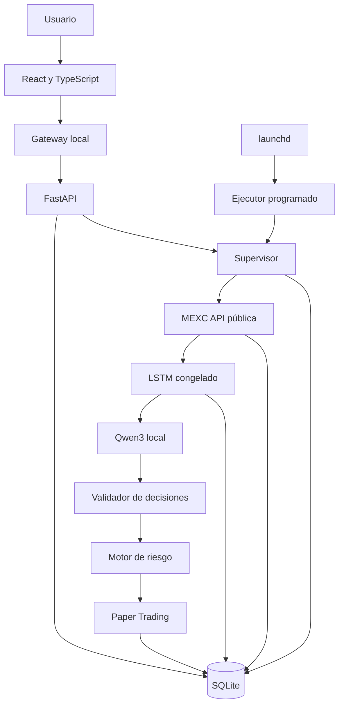
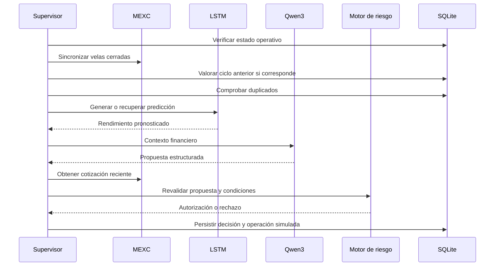

# Arquitectura técnica de FinanceAI

## 1. Descripción general

FinanceAI es una plataforma académica local de predicción
financiera y negociación simulada.

Su arquitectura separa la presentación, la comunicación HTTP,
la predicción cuantitativa, el razonamiento del agente,
la autorización financiera y la persistencia.

## 2. Arquitectura lógica

## 3. Capas del sistema

### Presentación

Frontend construido mediante React, TypeScript y Vite.

Contiene ocho secciones:

- Dashboard.
- Mercado.
- Predicciones.
- Agente IA.
- Cartera.
- Operaciones.
- Riesgo.
- Incidentes.

### Comunicación

El gateway local proporciona acceso al frontend y comunica
las solicitudes autorizadas con FastAPI.

| Servicio | Dirección local |
|---|---|
| Dashboard y gateway | 127.0.0.1:5173 |
| FastAPI | 127.0.0.1:8000 |
| Ollama temporal | 127.0.0.1:11434 |

La clave de autenticación permanece en el backend.

### Predicción

El servicio de predicción carga los artefactos congelados
del modelo LSTM y sus escaladores.

Los archivos del modelo se verifican mediante SHA-256.

### Agente

Qwen3 recibe información financiera estructurada y genera
una propuesta BUY, SELL o HOLD.

El LLM no puede ejecutar órdenes directamente.

### Riesgo y ejecución

El motor determinista valida la propuesta y las condiciones
financieras antes de permitir cualquier operación simulada.

### Persistencia

SQLite conserva las entidades financieras, las decisiones,
las órdenes, el patrimonio y los registros de incidentes.

Se utilizan transacciones para mantener la consistencia.

## 4. Separación de ambientes financieros

| Ambiente | Finalidad |
|---|---|
| PAPER_LIVE | Simulación con información actualizada |
| REPLAY | Reproducción histórica controlada |
| REPLAY finalizado | Carteras históricas liquidadas |

Las simulaciones históricas utilizan bases independientes.
No modifican el capital de la cartera principal.

## 5. Flujo de un ciclo operativo

El flujo evita repetir una operación correspondiente a
una vela ya procesada.

## 6. Automatización

El servicio launchd inicia el ejecutor programado.
El ejecutor comprueba la ventana temporal, los registros
persistentes y los bloqueos concurrentes.

Posteriormente delega la ejecución al supervisor existente.

## 7. Restricciones de despliegue

- Aplicación local, no desplegada como servicio público.
- Entorno de integración macOS ARM64.
- Ollama ejecutado localmente.
- Servicio launchd dependiente de la sesión de usuario.
- Operaciones exclusivamente virtuales.
- Primer ciclo automático con mercado actualizado pendiente.

## 8. Inventario de módulos del backend

### `backend/app/__init__.py`

Módulo de configuración, clases o soporte.

### `backend/app/api/__init__.py`

Módulo de configuración, clases o soporte.

### `backend/app/api/agent_control.py`

- `change_status()`
- `update_status()`
- `run_with_ollama()`
- `run_manual_cycle()`
- `control_endpoint()`

### `backend/app/api/agent_monitor.py`

- `utc()`
- `read_agent_state()`
- `probe_ollama()`
- `read_decisions()`
- `agent_status()`
- `agent_decisions()`

### `backend/app/api/agent_recovery.py`

- `principal()`
- `recovery_overview()`
- `validate_reason()`
- `recover_incidents()`
- `reset_emergency()`
- `recovery_endpoint()`
- `recovery_action()`

### `backend/app/api/market.py`

- `timestamp_fecha()`
- `buscar_activo()`
- `serializar_vela()`
- `get_assets()`
- `get_candles()`
- `get_latest()`
- `get_risk_config()`

### `backend/app/api/portfolio_history.py`

- `utc()`
- `principal()`
- `portfolio_overview()`
- `order_history()`
- `overview_endpoint()`
- `orders_endpoint()`

### `backend/app/api/prediction_history.py`

- `utc()`
- `prediction_history()`
- `history_endpoint()`

### `backend/app/api/predictions.py`

- `get_latest_prediction()`
- `create_prediction()`

### `backend/app/api/risk_incidents.py`

- `utc()`
- `serialize_config()`
- `risk_overview()`
- `incident_history()`
- `risk_endpoint()`
- `incidents_endpoint()`

### `backend/app/api/status.py`

- `system_status()`
- `get_database_status()`
- `model_status()`
- `get_portfolio()`

### `backend/app/core/__init__.py`

Módulo de configuración, clases o soporte.

### `backend/app/core/config.py`

- `load_api_key()`

### `backend/app/core/database.py`

- `read_connection()`
- `write_transaction()`
- `database_status()`

### `backend/app/core/security.py`

- `verify_api_key()`

### `backend/app/dashboard_gateway.py`

- `create_app()`

### `backend/app/main.py`

- `root()`
- `health()`

### `backend/app/repositories/__init__.py`

Módulo de configuración, clases o soporte.

### `backend/app/schemas/__init__.py`

Módulo de configuración, clases o soporte.

### `backend/app/services/__init__.py`

Módulo de configuración, clases o soporte.

### `backend/app/services/agent_context.py`

- `load_live_context()`
- `propose_live_decision()`
- `temporary_ollama()`
- `main()`

### `backend/app/services/agent_cycle.py`

- `cycle_lock()`
- `operational_status()`
- `finalize_previous_valuation()`
- `existing_cycle()`
- `run_once()`
- `main()`

### `backend/app/services/agent_risk.py`

- `build_risk_inputs()`
- `preview_action()`
- `operational_blockers()`
- `verify_unchanged_context()`
- `preview_live_decision()`
- `main()`

### `backend/app/services/agent_supervisor.py`

- `classify_error()`
- `get_portfolio()`
- `pending_incidents()`
- `record_failure()`
- `supervisor_lock_path()`
- `preflight()`
- `run_guarded()`
- `recovery_status()`
- `resume_after_review()`
- `main()`

### `backend/app/services/financial_prompt.py`

- `build_context_data()`
- `build_messages()`
- `prompt_sha256()`
- `synthetic_context()`
- `main()`

### `backend/app/services/live_paper_trading.py`

- `cycle_summary()`
- `verify_proposal()`
- `execute_live_cycle()`
- `main()`

### `backend/app/services/llm_decision.py`

- `reject_duplicate_keys()`
- `reject_constant()`
- `validate_decision()`
- `request_decision()`
- `database_hash()`
- `model_hashes()`
- `main()`

### `backend/app/services/market_quote.py`

- `request_json()`
- `validate_quote()`
- `get_latest_quote()`
- `serialize_quote()`
- `main()`

### `backend/app/services/mexc.py`

- `request_json()`
- `get_server_time()`
- `normalize_candles()`
- `latest_stored()`
- `synchronize()`
- `main()`

### `backend/app/services/ollama_client.py`

- `main()`

### `backend/app/services/paper_trading.py`

- `execute_replay_cycle()`

### `backend/app/services/prediction.py`

- `sha256()`
- `verify_artifacts()`
- `load_model()`
- `build_features()`
- `infer_return()`
- `validate_window()`
- `serialize_prediction()`
- `get_prediction()`
- `latest_prediction()`
- `generate_prediction()`
- `main()`

### `backend/app/services/risk.py`

- `ceil_div()`
- `price_to_micros()`
- `reject()`
- `model_only_action()`
- `validate_config()`
- `evaluate()`
- `main()`

### `backend/audit_agent.py`

- `comprobar()`
- `sha256()`
- `impedir_ejecucion()`

### `backend/audit_backend.py`

- `verificar()`
- `sha256()`
- `huella_database()`
- `auditar_http()`

### `backend/audit_frontend.py`

- `comprobar()`
- `sha256()`
- `auditar_rutas()`
- `auditar_controles()`

### `backend/run_dashboard.py`

- `main()`

### `backend/run_scheduled_agent.py`

- `utc_now()`
- `normalize_time()`
- `inside_window()`
- `response()`
- `save_receipt()`
- `read_receipt()`
- `scheduled_runner()`
- `run_scheduled()`
- `main()`

### `backend/scheduler_state.py`

- `next_execution()`
- `inspect_launchd()`
- `read_scheduler_state()`
- `review_receipt()`
- `main()`

### `backend/test_ollama_local.py`

- `sha256()`
- `database_hash()`
- `get()`

