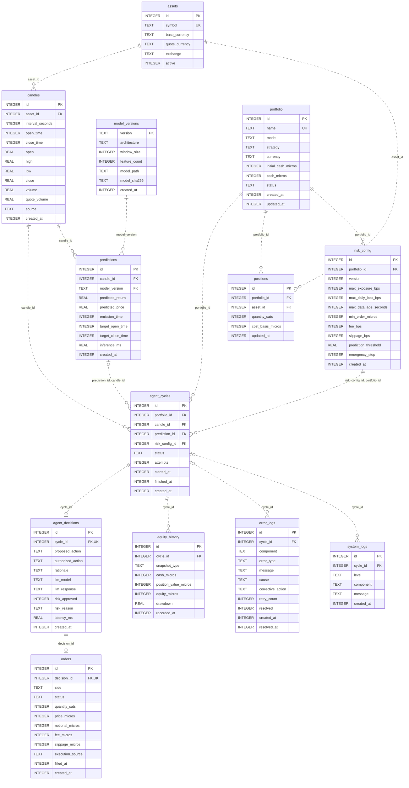

# Modelo entidad-relación — FinanceAI

El siguiente diagrama se genera automáticamente a partir
de las tablas, llaves e índices del esquema principal.

Las cardinalidades se deducen de las restricciones
de nulabilidad y unicidad declaradas en SQLite.

## Convenciones

- PK: llave primaria.
- FK: llave foránea.
- UK: restricción individual de unicidad.
- Las relaciones identificadoras se representan con línea continua.
- Las relaciones no identificadoras utilizan línea discontinua.
- Las restricciones UNIQUE compuestas se detallan en el
  diccionario de datos y en el esquema SQL.

La representación de cardinalidades corresponde a las
restricciones declaradas en la base de datos; no incluye
reglas adicionales de negocio implementadas en Python.
