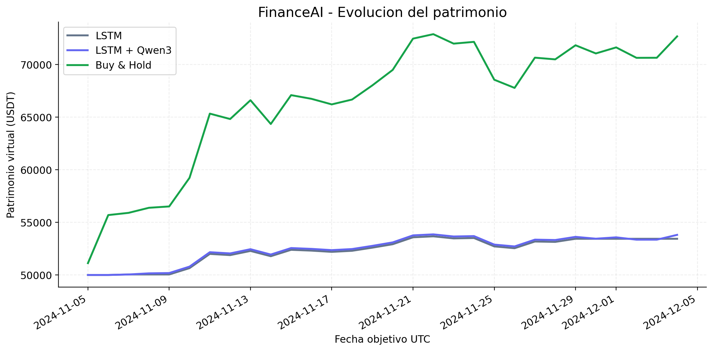
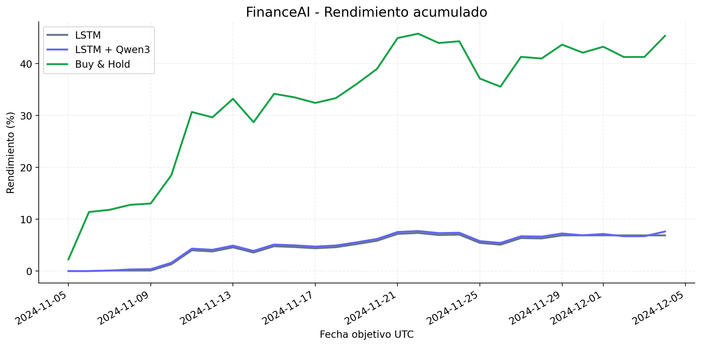
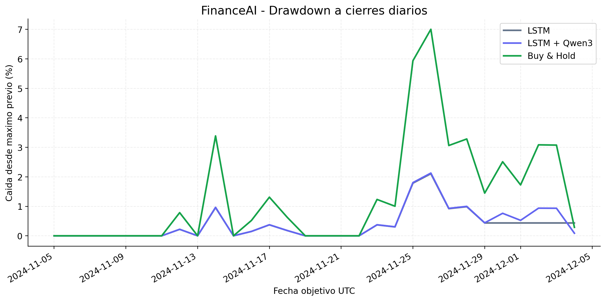

# FinanceAI — Reporte académico final

## Objetivo

Desarrollar un sistema de predicción financiera mediante
Deep Learning e integrar un agente local de inteligencia
artificial sujeto a controles deterministas de riesgo.

## Metodología

Se utilizaron datos diarios de BTCUSDT y una separación
cronológica de entrenamiento, validación y prueba.

Se compararon modelos de referencia, MLP y LSTM.

El modelo seleccionado fue TEC_B_LSTM_S42, con 20
observaciones, tres variables de entrada y 1425 parámetros.

El agente utiliza Qwen3:8b mediante Ollama.

## Resultados del modelo

En el conjunto de prueba original:

- MAE: 0.0160994954.
- RMSE: 0.02309500026.
- Precisión direccional: 46.9333%.
- Rendimiento de la estrategia: -32.716577%.
- Buy & Hold: -36.853415%.

La evaluación original no fue repetida durante la integración.

## Simulación comparativa

Periodo: 5 de noviembre al 4 de diciembre de 2024.

Capital inicial: 50,000 USDT virtuales por estrategia.

| Estrategia | Capital final USDT | Rendimiento | Drawdown |
|---|---:|---:|---:|
| LSTM | 53437.29 | 6.8746% | 2.1058% |
| LSTM + Qwen3 | 53810.28 | 7.6206% | 2.1274% |
| Buy & Hold | 72666.16 | 45.3323% | 7.0044% |

Se completaron 90 ciclos históricos y 30 inferencias
válidas del modelo de lenguaje.

La referencia pasiva complementaria con asignación inicial
del 25% obtuvo un rendimiento de 11.3331%.

## Gráficas

## Implementación

- Python y TensorFlow.
- FastAPI.
- React y TypeScript.
- SQLite con 13 tablas principales.
- Qwen3 mediante Ollama.
- Programador diario launchd.

## Validación técnica

- 450 pruebas aprobadas.
- Cero pruebas fallidas.
- 10 escenarios adversos verificados.
- 20 controles de autenticación.
- 15 llaves foráneas.
- 122 columnas documentadas.

## Limitaciones

El replay corresponde a 30 días retrospectivos del
conjunto de validación, con ejecución idealizada y costos cero.

Las estrategias presentan diferentes niveles de exposición.

El LLM puede contener conocimiento posterior al periodo evaluado.

El primer ciclo automático con mercado actualizado está pendiente.

## Conclusión

FinanceAI demuestra la integración de modelos predictivos,
agentes de inteligencia artificial y bases de datos dentro
de una plataforma financiera simulada.

Qwen3 mejoró ligeramente el rendimiento frente al modelo
cuantitativo en el periodo histórico seleccionado. Sin
embargo, Buy & Hold obtuvo el mayor rendimiento.

Los resultados no demuestran rentabilidad futura.

El proyecto tiene una finalidad exclusivamente académica.
