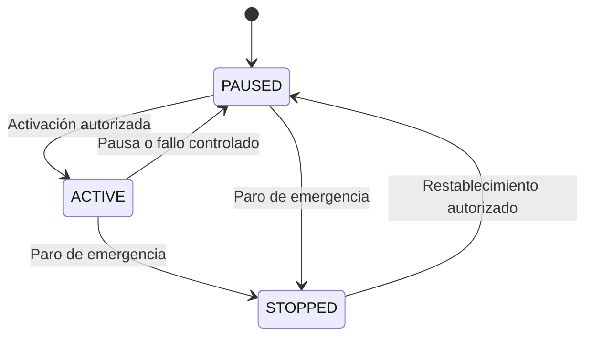

# Seguridad operativa y financiera

## 1. Principio fundamental

FinanceAI funciona exclusivamente con capital virtual.

El modelo de lenguaje propone decisiones, pero no
tiene permisos directos de ejecución financiera.

## 2. Protección de credenciales

- Clave de autenticación almacenada localmente.
- Archivo `.env` excluido de la distribución.
- Credenciales no incorporadas al frontend.
- Comunicación mediante servicios locales.
- Confirmaciones explícitas para controles operativos.

La aplicación no debe exponerse directamente a internet
sin diseñar controles adicionales de despliegue.

## 3. Configuración financiera inicial

| Control | Valor |
|---|---|
| Capital virtual | 50,000 USDT |
| Exposición para nuevas compras | 25% |
| Restricción diaria de pérdidas para compras | 2% |
| Antigüedad máxima de vela | 3600 segundos |
| Antigüedad máxima de cotización | 60 segundos |
| Orden mínima | 10 USDT |
| Comisión | 0% |
| Deslizamiento | 0% |
| Apalancamiento | No |
| Posiciones cortas | No |

El límite de exposición restringe nuevas compras.
La apreciación de una posición existente puede
elevar la exposición por encima del 25%.

El límite de pérdidas tampoco garantiza que el
patrimonio no pueda superar esa caída.

Las ventas destinadas a reducir riesgo siguen sujetas
a las validaciones operativas correspondientes.

## 4. Precisión financiera

El efectivo se representa mediante microunidades
de USDT y las posiciones de Bitcoin mediante satoshis.

La ejecución utiliza cantidades enteras para reducir
los errores de redondeo y facilitar la reconciliación.

## 5. Estados de cartera



Los incidentes pendientes y los controles de
recuperación pueden impedir la activación.

## 6. Escenarios adversos verificados

| Escenario | Respuesta comprobada |
|---|---|
| MEXC no responde | Tres intentos máximos ante timeout y pausa segura |
| HTTP 429 | Detención de solicitudes y clasificación del incidente |
| Datos obsoletos | Bloqueo de operaciones |
| Ollama desconectado | Sin ejecución de órdenes |
| JSON inválido | Rechazo de la propuesta |
| API Key incorrecta | HTTP 401 |
| Saldo insuficiente | Compra bloqueada |
| Ciclo duplicado | Persistencia idempotente |
| Reinicio | Conservación de incidentes y recuperación controlada |
| Paro de emergencia | Bloqueo de operaciones |

Los escenarios se verificaron mediante pruebas
controladas, no provocando fallos reales del mercado.

## 7. Seguridad del programador

El programador admite un intento automático diario
dentro de la ventana 00:05–00:45 UTC.

Conserva registros persistentes de cada intento.

| Estado del registro | Significado |
|---|---|
| STARTED | Intento iniciado |
| FINISHED | Supervisor finalizado |
| FAILED | Fallo del ejecutor |
| REVIEWED | Intento revisado manualmente |

Un resultado FINISHED no implica necesariamente
que se haya ejecutado una orden.

Los registros interrumpidos o fallidos requieren
revisión antes de continuar automáticamente.

La revisión no repite el intento del mismo día.

### Consultar estado

```bash
python -m backend.scheduler_state
```

### Revisar un intento interrumpido

La cartera debe estar pausada y no tener incidentes
pendientes ni ciclos incompletos.

```bash
python -m backend.scheduler_state   --review AAAA-MM-DD   --reason "Motivo documentado de la revisión"   --confirm PAPER_ONLY
```

Los registros corruptos requieren intervención técnica.

## 8. Evidencias de auditoría

- 450 pruebas automatizadas aprobadas.
- 10 escenarios adversos.
- 20 controles de autenticación.
- 90 ciclos históricos.
- 30 inferencias válidas de Qwen3.
- Tres carteras históricas liquidadas.

El primer ciclo automático con mercado actualizado
permanece pendiente de verificación.

## 9. Gestión de riesgos de publicación

La distribución debe excluir claves, bases operativas,
archivos WAL y SHM, bloqueos, entornos virtuales,
dependencias generadas y registros sensibles.

La selección final de archivos se auditará antes
de publicar el repositorio o generar el ZIP.
